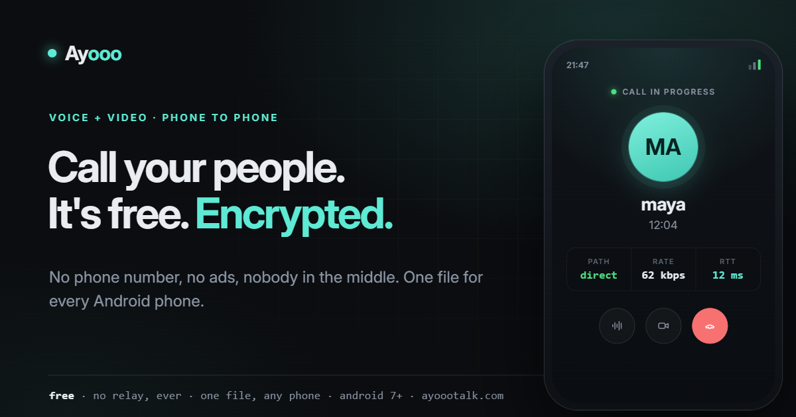

# Ayooo — free encrypted voice and video calls for Android

**One-to-one calls over Wi-Fi, 4G, or 5G. No phone number, no ads, no ad or analytics SDKs, no call recording.**

[](https://github.com/Stevechaapps/AyoooTalk/releases/latest/download/Ayooo.apk)
[](https://github.com/Stevechaapps/AyoooTalk/releases)
[](https://ayoootalk.com/help)
[](LICENSE)
[](https://ayoootalk.com)

> **In short:** Ayooo is a free Android app for private 1:1 voice and video calls over data. It needs no phone number, shows no ads, and adapts the call to weak mobile networks. Media travels directly between the two phones and is encrypted in transit. Ayooo is not open source and is not on Google Play; the APK is published in [Releases](https://github.com/Stevechaapps/AyoooTalk/releases).

---

## At a glance

| | |
| --- | --- |
| **App** | Ayooo |
| **Platform** | Android 7.0+ (API 24) |
| **Call types** | 1:1 voice and 1:1 video |
| **Identity** | Username + password — no phone number, email, or SIM |
| **Network** | Wi-Fi, 4G, 5G; adaptive low-bandwidth profiles |
| **Media path** | Direct phone-to-phone (STUN); no TURN relay in the public service |
| **Media encryption** | DTLS-SRTP, encrypted in transit |
| **Price** | Free; no ads, no subscriptions, no in-app purchases |
| **Account recovery** | None, by design — no email or phone number is collected |
| **Size** | ~27 MB universal; ~15 MB arm64 |
| **Latest version** | 1.4.10 (November 2026) |
| **Source** | Proprietary; this repository hosts release builds only |
| **Website** | [ayoootalk.com](https://ayoootalk.com) |

---

## Download

| Build | Best for | Size | Download |
| --- | --- | --- | --- |
| **Universal** | Almost every Android phone. Start here if unsure. | ~27 MB | [**Ayooo.apk**](https://github.com/Stevechaapps/AyoooTalk/releases/latest/download/Ayooo.apk) |
| arm64-v8a | Most phones made since ~2017 | ~15 MB | [Ayooo-arm64-v8a.apk](https://github.com/Stevechaapps/AyoooTalk/releases/latest/download/Ayooo-arm64-v8a.apk) |
| armeabi-v7a | Older 32-bit phones | ~13 MB | [Ayooo-armeabi-v7a.apk](https://github.com/Stevechaapps/AyoooTalk/releases/latest/download/Ayooo-armeabi-v7a.apk) |

Prefer the website? [ayoootalk.com](https://ayoootalk.com) is the primary download
page. Its Download button keeps the branded
`https://ayoootalk.com/downloads/ayooo.apk` URL and resolves to the latest asset
in this repository, so existing links and QR codes keep working. This repository
is the binary origin; the site is the front door.

Every release also ships `SHA256SUMS.txt`. Verify the file before installing:

```powershell
# Windows
Get-FileHash .\Ayooo.apk -Algorithm SHA256
```

```bash
# Linux / macOS
sha256sum -c SHA256SUMS.txt
```

The checksum is the best way to confirm the APK is the one published here. If it does not match, do not install it.

---

## What is Ayooo?

Ayooo is a free Android calling app built for two people, not for a platform. You create an account with a username and password, add someone by username, and call once they accept. There is no phone number, no email address, no contact upload, and no social graph to feed.

The call itself is negotiated directly between the two phones. The server rings the bell, relays the connection details, and then steps out of the media path. Audio and video are encrypted in transit with DTLS-SRTP, the same standard WebRTC stack browsers use. The server does not record, store, or listen to the audio or video.

It is deliberately small in scope: Android, one-to-one, voice and video. No groups, no chat, no screen sharing, no feed. What it does have is an unusually careful approach to bad networks — the thing most calling apps treat as an afterthought.

---

## Why people use it

- **No phone number.** Your username is the address. Nothing to leak, recycle, or SIM-swap.
- **No ads or third-party analytics.** No ad SDK, no tracker, no third-party analytics library.
- **Built for prepaid data.** Three profiles, from 24 kbps audio and 240p video up to 48 kbps audio and 720p video.
- **Rescue mode.** When the line degrades, Ayooo lowers the video step by step — 240p, then 144p — and finally pauses the camera to protect the conversation. It restores video when the line recovers.
- **Receipts, not vibes.** The call screen shows the path the call took (direct on the public service), bitrate, round-trip time, jitter, loss, and a MOS quality estimate.
- **Only accepted contacts can ring you.** A stranger cannot call you. A declined request cannot be sent again for 7 days.
- **Ringing works in the background.** A foreground service keeps the signaling socket alive, and Firebase push wakes the phone if the process was killed.

---

## Features

### Calling

- 1:1 voice and video.
- Front/back camera switch, mute, speaker.
- Live call diagnostics: path, bitrate, RTT, jitter, packet loss, MOS.
- ICE restart when the network changes, so a Wi-Fi-to-mobile handoff does not always end the call.
- Call quality and path are reported back to the service after the call. Audio and video are never recorded.

### Weak-network profiles

| Profile | Audio | Video | Packet time | Best for |
| --- | --- | --- | --- | --- |
| **Data saver** | 24 kbps Opus | 240×320 @ 15 fps, ≤150 kbps | 40 ms | 3G, congested cells, prepaid data |
| **Balanced** | 32 kbps Opus | 480×640 @ 24 fps, ≤400 kbps | 20 ms | Default |
| **High quality** | 48 kbps Opus | 720×1280 @ 30 fps, ≤1.2 Mbps | 20 ms | Wi-Fi, strong 5G |

Opus in-band FEC and DTX are enabled in every profile. Rescue mode steps the outgoing video down to 240p (150 kbps), then 144p (90 kbps), and only then pauses the camera.

### Privacy

- No phone number, email, or SIM required.
- No password recovery by design: with no email or phone number on file, there is nothing to reset against and no recovery channel to leak.
- Passwords are scrypt-hashed with a per-user salt.
- Session tokens are 24 random bytes; only a SHA-256 digest is stored. Tokens expire after 30 days, and signing out revokes the session on the server.
- Media is encrypted with DTLS-SRTP. The signaling server sees connection metadata and SDP, not the media itself.
- No ads, no third-party analytics, no call recording.

### Contacts and ringing

- Contact requests must be accepted. Nobody can ring a stranger.
- Online presence dot for accepted contacts.
- A declined request has a 7-day cooldown.
- Foreground service keeps the app reachable between calls.
- High-priority incoming-call notification with the ring sound and a full-screen answer screen where Android allows it.

---

## How a call works

```text
  Phone A                 Signaling (Worker + Durable Object)                 Phone B
     |                              |                                            |
     |  1. call request ----------> | ----------> incoming call ---------------> |
     |                              |                                            |
     |  2. SDP offer / ICE ---------|---------- SDP answer / ICE ---------------> |
     |                              |                                            |
     |  3. DTLS handshake + SRTP media ========== direct ======================> |
     |                              |                                            |
     |  4. quality samples ---------|---------- call record --------------------> |
```

1. Both people are signed in and have accepted each other as contacts.
2. The caller sends a call request. The server rings the other phone.
3. The phones exchange SDP and ICE candidates through the server.
4. Media flows directly between the phones. STUN discovers a path through NAT; the public service does not operate a TURN media relay.
5. Each side samples bitrate, RTT, jitter, loss, and MOS. Rescue mode uses those samples to protect the call.

---

## Install on Android

1. **Download** `Ayooo.apk` from the link at the top of this page.
2. **Open it from Files or File Manager.** Some phones block the browser's own installer; the file manager usually works.
3. **Allow installs from this source** when Android asks. This is the standard warning for every app installed outside a store.
4. **Create an account.** Username: 3–20 characters, `a-z`, `0-9`, `_`. Password of your choice. **There is no password recovery** — no email or phone number is collected, so save the password in a password manager.
5. **Allow microphone, camera, and notifications.** Accept the battery-optimization prompt so Android does not pause the app in the background.
6. **Add a contact by username.** They accept, then either of you can call.
7. **Updates:** when a new version is out, the app shows a card. One tap opens the download, and Android replaces the app in place while keeping your account and contacts.

Works on Android 7.0 and newer. Calling does not depend on a Google account. Incoming-call push uses Firebase Cloud Messaging, which needs Google Play Services on most phones; without it, the app must be running to ring.

---

## Security and privacy

### What the service can see

| It can see | It cannot see |
| --- | --- |
| Username and display name | Your password (only a scrypt hash is stored) |
| Your contact list | Your session token (only a SHA-256 digest is stored) |
| Call metadata: who, when, duration, path, quality | Audio or video content |
| Connection metadata, including IP address | Your phone number, email, or contacts from your address book |

### What is encrypted

- **Media:** DTLS-SRTP between the phones. A direct call's media does not pass through the signaling server.
- **Passwords:** scrypt with a per-user salt.
- **Sessions:** random 24-byte tokens, stored as SHA-256 digests, 30-day expiry, server-side revocation on sign-out.
- **Signaling:** WSS/TLS in transit.

### What is not claimed

Ayooo has not been independently security-audited. "Encrypted in transit" is a technical description of the WebRTC stack, not a certification. The signaling server relays SDP and call metadata; it does not carry the media on a direct call. If your threat model requires a formally audited messenger, use one.

---

## Honest limitations

- **Android only.** No iOS or web client.
- **1:1 only.** No group calls, no chat, no screen sharing.
- **Not on Google Play.** You sideload the APK and update it from inside the app.
- **Direct-only media.** The public service uses STUN, not a TURN relay. On the strictest carrier-grade NAT or a network that blocks UDP, a direct path may not exist and the call may fail. This is deliberate: no relay means no server copy of the call.
- **Incoming calls need the process alive.** Push usually wakes it, but aggressive OEM battery managers (Xiaomi, vivo, OPPO, and friends) can still block it. The app asks for the battery exemption.
- **No phone number means no PSTN and no ViLTE.** Ayooo cannot call a phone number, and it cannot use your carrier's VoLTE/ViLTE service.
- **Not independently audited.** See above.
- **Source is proprietary.** This repository publishes binaries and documentation, not the app source.

---

## Ayooo vs. other calling apps

| | **Ayooo** | WhatsApp | Signal | Phone dialer |
| --- | --- | --- | --- | --- |
| Phone number required | **No** | Yes | Yes | Yes |
| Calls over data | **Yes** | Yes | Yes | No |
| Media encryption | **DTLS-SRTP, direct** | E2EE | E2EE | Carrier |
| Group calls | **No** | Yes | Yes | Carrier-dependent |
| Ads | **No** | No | No | No |
| Open source | **No** | No | Yes | No |
| Install from GitHub | **Yes** | No | No | Preinstalled |

*As of November 2026. Features and policies change; check each vendor.*

Ayooo is not trying to replace a full messenger. It is for the call you make when the data is thin, the phone is old, and you would rather not hand over a phone number to do it.

---

## FAQ

### Is Ayooo free?

Yes. The app is free to download and use. There are no ads, subscriptions, or in-app purchases.

### Do I need a phone number or email?

No. You sign up with a username and password. There is no phone number, email, SIM, or social login.

### What if I forget my password?

There is no password reset and no account recovery. Ayooo never collects an email address or phone number, so there is nothing to verify you with and no recovery channel to store, leak, or attack. Choose a password you will remember, or save it in a password manager. Losing it means losing the account.

### Is Ayooo end-to-end encrypted?

Media is encrypted in transit with DTLS-SRTP between the two phones. On a direct call, the media does not pass through the signaling server. Ayooo has not been independently audited, so it does not claim a formal E2EE certification.

### Does it work on Smart, TNT, Globe, or DITO?

Yes. Ayooo uses ordinary mobile data, so it works on any operator. It is not the carrier's ViLTE service. ViLTE is a dialer-only carrier feature and cannot be used by a third-party app; Ayooo does not use it.

### Does Ayooo use ViLTE or VoLTE?

No. Ayooo is a data application. ViLTE and VoLTE are IMS services inside your carrier's network, available only through the phone's dialer. Ayooo cannot place or receive those calls.

### Can I call someone who does not have Ayooo?

No. Both people need the app and must accept each other as contacts. Ayooo does not call phone numbers or landlines.

### Does it work when the app is closed?

Usually. A foreground service keeps the signaling connection alive, and Firebase push wakes the phone if Android killed the process. Some OEM battery managers can still suppress it; the app asks for the battery exemption.

### Why is it not on Google Play?

Direct distribution keeps the install small, avoids store fees and review delays, and lets updates ship immediately. The trade-off is the "install unknown apps" warning and manual updates.

### How do updates work?

The app checks a small version file when the home screen opens. If a newer version exists, it shows a card. Tapping it opens the download, and Android replaces the app in place, keeping your account and contacts.

### Is it safe to sideload?

Sideloading is normal on Android, but verify the SHA-256 checksum and install only from this repository or [ayoootalk.com](https://ayoootalk.com). Android warns about every app installed outside a store, not just this one.

### Does it work on 2G or 3G?

Audio may work on a usable 3G link with the Data saver profile. Video generally will not. On 2G/EDGE, expect the call to fail.

### Can I use it on iPhone?

No. There is no iOS client today.

### Are there group calls?

Not yet. Ayooo is one-to-one only.

### Is Ayooo open source?

No. Ayooo is free to use, but the source is proprietary. This repository hosts release builds, documentation, and issue tracking.

### How big is the app?

About 27 MB for the universal APK, about 16 MB for the arm64 build.

### Which Android versions are supported?

Android 7.0 (API 24) and newer.

---

## Tech stack

- **App:** Flutter and Dart, with `flutter_webrtc` for capture, encoding, and peer connections.
- **Audio:** Opus with in-band FEC and DTX; bitrate and packet time forced into the SDP per profile.
- **Video:** Camera constraints per profile, plus live sender-side bitrate, frame-rate, and resolution scaling for rescue mode.
- **Signaling:** Cloudflare Worker, Durable Object, and D1; WebSocket for presence, ringing, SDP, and ICE.
- **Push:** Firebase Cloud Messaging for incoming calls when the app is not running.
- **NAT traversal:** STUN (Cloudflare and Google). The public service does not run a TURN relay.
- **Diagnostics:** RTT, jitter, loss, bitrate, relay/direct path, and an E-model MOS estimate.
- **Release builds:** Universal APK plus split-per-ABI (arm64-v8a, armeabi-v7a). Release builds are R8-minified and Dart-obfuscated; mapping and symbol files stay private.

---

## Project status

Ayooo is maintained and actively released. The current version is **1.4.10** (November 2026). The scope is intentionally narrow: Android, one-to-one, voice and video. New releases are tagged `vX.Y.Z` in [Releases](https://github.com/Stevechaapps/AyoooTalk/releases).

Bug reports and install questions are welcome in [Issues](https://github.com/Stevechaapps/AyoooTalk/issues). There is no public roadmap and no promise of group calls, iOS, or a web client.

---

## Links

- **Website:** [ayoootalk.com](https://ayoootalk.com)
- **Help and install guide:** [ayoootalk.com/help](https://ayoootalk.com/help)
- **Terms:** [ayoootalk.com/terms](https://ayoootalk.com/terms)
- **Support the project:** [ayoootalk.com/donate](https://ayoootalk.com/donate)
- **Releases:** [github.com/Stevechaapps/AyoooTalk/releases](https://github.com/Stevechaapps/AyoooTalk/releases)
- **Issues:** [github.com/Stevechaapps/AyoooTalk/issues](https://github.com/Stevechaapps/AyoooTalk/issues)
- **Security policy:** [SECURITY.md](SECURITY.md)

---

## License

Ayooo is proprietary software. Copyright © 2026 Stevechaapps. All rights reserved.

The compiled application is free to download and use. Reverse engineering, decompilation, modification, redistribution, repackaging, and resale of the app or its binaries are prohibited. See [LICENSE](LICENSE), [NOTICE.md](NOTICE.md), and the [Terms](https://ayoootalk.com/terms).

Ayooo is independent and is not affiliated with Smart, TNT, Globe, DITO, Google, or Meta. ViLTE, VoLTE, and Wi-Fi Calling are carrier services; Ayooo does not use them.
